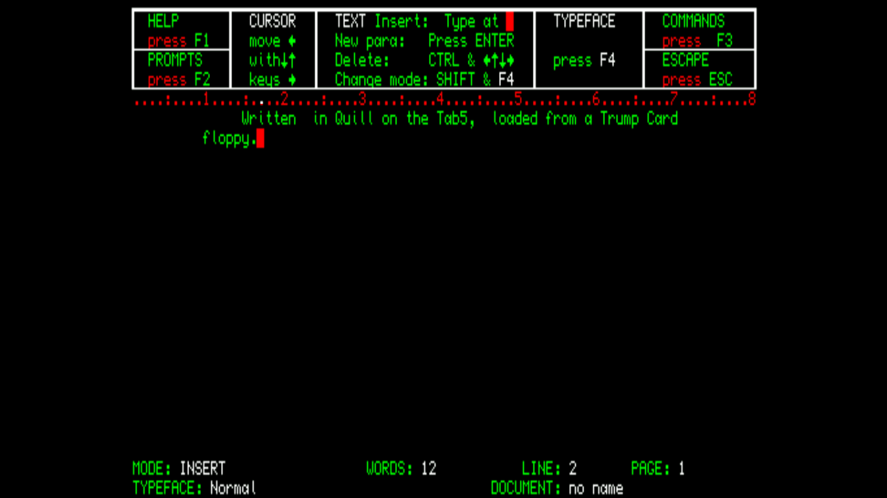
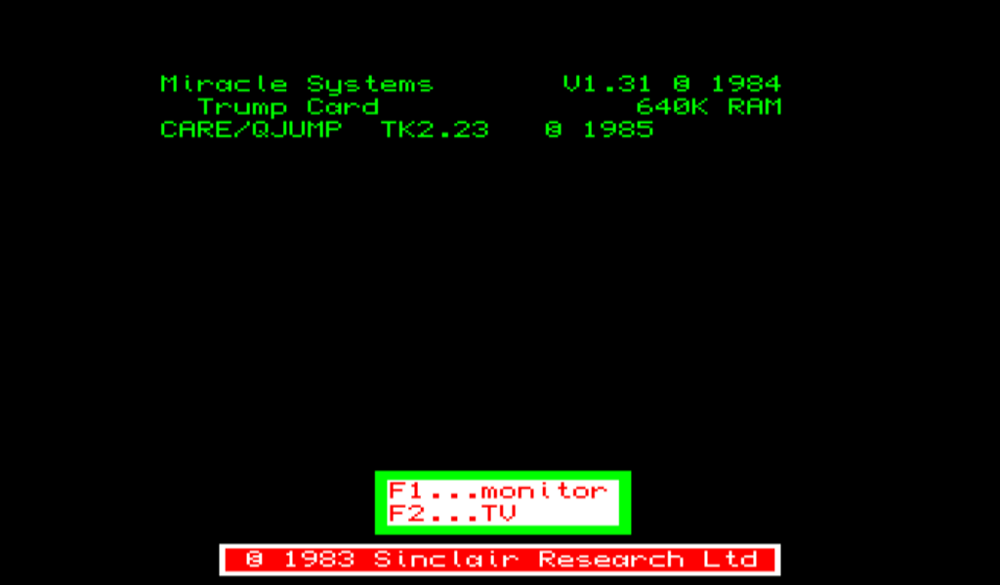
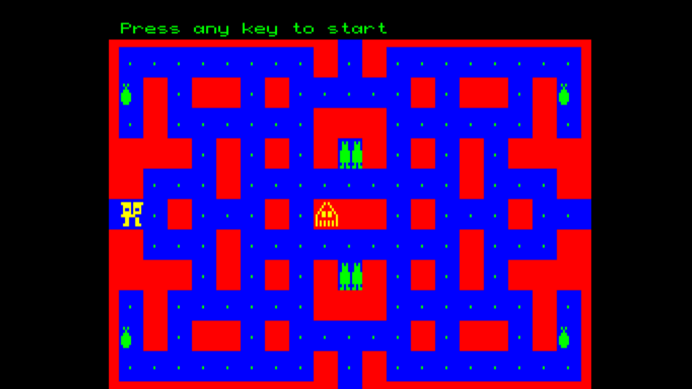
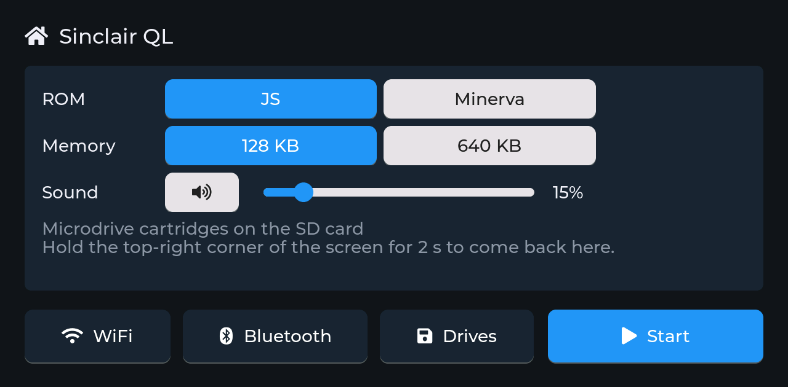
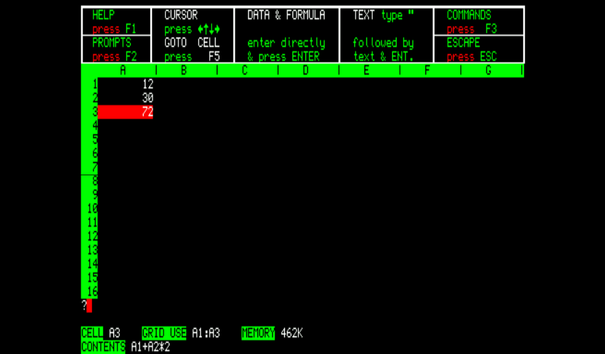

<h1 align="center">esp32ql</h1>

<p align="center">
  <b>A Sinclair QL on a 7-inch ESP32-S3 touch-screen board or an M5Stack Tab5.</b><br>
  A 68008 with the QL's 8-bit bus timing, the ZX8301's two display modes, the JS or Minerva ROM, 128 or 640 KB,<br>
  Microdrives, and floppy disks on a Miracle Trump Card.
</p>

<p align="center">
  
  
  
  
  
  
</p>

<p align="center">
  <b>Early development:</b> QDOS, SuperBASIC, the keyboard, sound, the Microdrives, floppy
  disks and the serial ports work on both boards.
</p>

<p align="center">
  
  
  <br>
  
  
  <br>
  
  
  <br>
  <sub>Psion Quill 2.35 booted from a floppy disk on the Tab5; the MaTouch starting with a Trump
  Card; Pacman from a freeware game cartridge (mode 8, 256 × 256, eight colours); the setup
  screen; Quill from a Microdrive cartridge, a document just saved back to it; Psion Abacus from a
  floppy disk on the MaTouch. Screenshots from the boards.</sub>
</p>

esp32ql turns the Makerfabs MaTouch ESP32-S3 Parallel TFT with Touch 7", or an
M5Stack Tab5, into a Sinclair QL. A setup screen on the touch panel, and a web
page on your network, handle the machine's settings and its Microdrive
cartridges and floppy disks on the microSD card.

It's the sibling of [esp32ste](https://github.com/rlucencic/esp32ste) (Atari
STE), [esp32mac](https://github.com/rlucencic/esp32mac) (Macintosh Plus, SE,
Classic), [esp32mac2](https://github.com/rlucencic/esp32mac2) (Macintosh LC
and II, Tab5 only), [esp32mac3](https://github.com/rlucencic/esp32mac3)
(Macintosh LC II and LC III, Tab5 only),
[esp32oric](https://github.com/rlucencic/esp32oric) (Oric Atmos and Oric-1),
[esp32cpc](https://github.com/rlucencic/esp32cpc) (Amstrad CPC),
[esp32zx](https://github.com/rlucencic/esp32zx) (ZX Spectrum 128K, +2, +3),
[esp32cbm](https://github.com/rlucencic/esp32cbm) (Commodore 64 and 128),
[esp32xl](https://github.com/rlucencic/esp32xl) (Atari 800XL and 130XE),
[esp32msx](https://github.com/rlucencic/esp32msx) (MSX1 and MSX2),
[esp32gs](https://github.com/rlucencic/esp32gs) (Apple IIGS),
[esp32coco](https://github.com/rlucencic/esp32coco) (Tandy Color Computer 2
and 3), [esp32arc](https://github.com/rlucencic/esp32arc) (Acorn Archimedes,
Tab5 only), [esp32pc](https://github.com/rlucencic/esp32pc) (IBM PC/XT and
PC/AT), [esp32electron](https://github.com/rlucencic/esp32electron) (Acorn
Electron) and [esp32ami](https://github.com/rlucencic/esp32ami) (Amiga 500,
2000, 600 and 1200, Tab5 only); all are built on the shared runtime
[esp32emu](https://github.com/rlucencic/esp32emu), which also holds the 68000
core (Musashi) this one shares with the ST, the Macs and the Amiga.

## Status

**Working**
- The 68008: Musashi's 68000 with the QL's 8-bit bus (a word costs two byte
  cycles), 20 address lines, 7.5 MHz, a 50 Hz PAL frame of 312 lines.
- Memory: the 48 KB ROM, 128 KB RAM, or 640 KB with a 512 KB expansion;
  the ZX8301's contention (the screen's reads hold up the CPU's accesses to
  the on-board RAM), so programs run at a QL's speed: the QLay SuperBASIC
  benchmark gives 940 / 840 / 1160 on the Tab5, a QL 980 / 840 / 1100.
- The ZX8301's display: mode 4 (512 × 256, four colours) and mode 8 (256 ×
  256, eight colours, flashing), the two screen banks, blanking.
- The ZX8302's interrupts (frame, gap, interface, with their masks), its
  clock and its link to the IPC.
- The IPC (the 8049) at the protocol level: the keyboard (keys, SHIFT,
  CTRL, ALT, QDOS's autorepeat, KEYROW) and its status.
- **Sound**: BEEP with all its parameters (pitch, a second pitch, steps,
  wrap, random, fuzzy, duration), made as the IPC makes it: its timer
  interrupt's routine, step by step and cycle by cycle, so pitches and
  lengths come out as on a QL (`BEEP 0,50` is 189 Hz). Checked edge by edge
  against the IPC's own code run in an 8049 interpreter.
- The keyboard: Bluetooth and USB keyboards (the Tab5 Keyboard too) by
  position, Backspace and Delete as the QL's CTRL + ← and CTRL + →, F6-F10
  as SHIFT + F1-F5, Pause as CTRL + SPACE (break), the keypad's digits and
  signs. `tools/keytest.bas` shows each key's code and the keys held;
  checked by hand with a Bluetooth keyboard (every key) and the Tab5
  Keyboard.
- The JS ROM (QDOS 1.10) and Minerva 1.98 boot to SuperBASIC on both boards
  at full speed (the Tab5's emulation core ~22% busy, the MaTouch's ~64%);
  Minerva's start options too (F3/F4 two screens, SHIFT for 128 KB). The
  QL's clock follows the board's, and once set with SDATE or ADATE the
  board keeps the difference.
- **Microdrives**: MDV1_ and MDV2_ with cartridge images on the SD card
  (QLay `.mdv`, 174930 bytes, the format of the QL software collections),
  a tape loop with its gaps and records under the ZX8302's control:
  FORMAT (a blank cartridge from the setup screen or web page gives ~230
  sectors, as a real one does), SAVE, LOAD, DIR, and cartridges booting
  their `BOOT` program. Psion Quill 2.35 loads from its cartridge, and a
  document saved in it comes back. Written cartridges go back to the card
  two seconds after the last write.
- **Floppy disks**: a Miracle Trump Card (setup screen: Floppy) with its
  own ROM (V1.31: the FLP_ driver, RAM disks, Toolkit 2) and its WD1772
  disk controller; FLP1_ and FLP2_ take 720 KB disk images (`.img`, raw
  sectors). FORMAT gives 1440 sectors, SAVE, LOAD, DIR, WCOPY work, and the
  card boots `flp1_boot`: Quill copied from its cartridge boots from a disk
  in a few seconds. Written disks go back to the card two seconds after
  the last write.
- **Original software**: Psion Quill, Abacus, Archive and Easel from
  cartridges and floppy disks; the djw site's 29 freeware game cartridges
  (Pacman, Space Invaders, Psion Chess, Q-Bert, M-Cosmic, Cavern, ...) all
  run. Images prepared for the vDrive (whose header checksums are stale,
  and some with a blank stretch at the end) are put right as they go in.
- **QL software from the web page**: drop QL files, folders or zips on it
  and they go onto a new cartridge (when they fit) and a new 720 KB floppy
  disk, made in the browser and uploaded; executables keep their QDOS
  headers (type and data space), which QL zips carry in their extra
  fields. `tools/mdvtool.py` does the same for a cartridge on the PC;
  `tools/mdvcheck.py` checks one.
- **Serial ports**: SER1 and SER2 on the network, as TCP ports 2301 and
  2302. What the QL prints to a `ser1` channel goes out at its baud rate
  to whoever is connected, and what the PC sends the QL receives through
  the IPC as on a QL: `LOAD ser1z` loads a SuperBASIC program sent from
  the PC.

**Next**: the QL network, if wanted.

## Hardware

- **Makerfabs MaTouch ESP32-S3 Parallel TFT with Touch 7"** (ESP32-S3,
  16 MB flash, 8 MB PSRAM, 1024 × 600), or
- **M5Stack Tab5** (ESP32-P4, 1280 × 720).
- A microSD card (FAT32 or exFAT) for the cartridges and disks, a Bluetooth
  keyboard (the Tab5: USB too).

## Getting started

You need ESP-IDF 5.5 and [esp32emu](https://github.com/rlucencic/esp32emu)
cloned next to this repository.

1. Put the ROM images into `roms/` (`js.rom`, `minerva.rom`, and
   `trumpcard.rom` for floppy disks: see [roms/README.md](roms/README.md)).
2. Build and flash (`flash` also writes the ROMs into their partition):
   ```sh
   # MaTouch
   idf.py build && idf.py -p PORT flash
   # Tab5
   idf.py -B build-tab5 -DIDF_TARGET=esp32p4 -DSDKCONFIG=$PWD/build-tab5/sdkconfig build
   idf.py -B build-tab5 -DIDF_TARGET=esp32p4 -DSDKCONFIG=$PWD/build-tab5/sdkconfig -p PORT flash
   ```
3. On the setup screen choose the ROM, memory and floppy interface, and tap
   Start. The web page is at `http://sinclair-ql.local`.
4. Answer the QL's question with F1 (monitor) or F2 (TV) on a Bluetooth or
   USB keyboard; SuperBASIC follows (it first looks for `mdv1_boot`: a
   cartridge with one in MDV1_ starts its program).
5. Cartridges: copy `.mdv` images into the SD card's `ql` folder, or upload
   them on the web page; insert them in MDV1_ or MDV2_ from the setup
   screen's Drives page or the web page. A new, blank cartridge needs
   `FORMAT mdv1_name` first.
6. Floppy disks (Floppy: Trump Card): `.img` images in the same folder, in
   FLP1_ or FLP2_; a blank one needs `FORMAT flp1_name`. The card boots
   `flp1_boot` when a disk is in FLP1_. Toolkit 2's commands come after
   `TK2_EXT`; to copy a cartridge to a disk, `WCOPY mdv1_ TO flp1_`.
7. QL software: drop its zip (or its files) on the web page. It arrives as
   `<name>.mdv` and `<name>.img` with the files on them, ready to insert.
   On the PC, `tools/mdvtool.py add formatted.mdv software.zip` puts a
   zip's files on a cartridge QDOS formatted.
8. Serial ports: connect to the board's TCP port 2301 (SER1) or 2302
   (SER2), e.g. `nc sinclair-ql.local 2301`; bytes pass as they are, one
   client a port. On the QL, `OPEN #3,ser1` and `PRINT #3,"hello"` send a
   line to it; `LOAD ser1z`, then the program sent from the PC with a
   CTRL-Z at its end, loads one.

## Development

The machine (`components/ql`) is platform independent; `components/ql/host`
builds it for a PC, far faster than real time:

```sh
make -C components/ql/host run          # 500 frames of the JS ROM, build/screen.ppm
QL_IO=1 ./components/ql/host/build/ql_host roms/js.rom 200 out.ppm   # every I/O access
```

`host_main.c` lists its other switches (traces, a stop at a PC, typed
text, keys, memory dumps, disassembly of the ROM).

## Roadmap

See [TODO.md](TODO.md) for proposed work and how to verify it.

## Credits

- The 68000 core: [Musashi](https://github.com/kstenerud/Musashi) by Karl
  Stenerud (MIT), in esp32emu.
- The QL's ROMs: Sinclair Research's QDOS and SuperBASIC (Tony Tebby, Jan
  Jones and others); Minerva by Laurence Reeves. Not part of this
  repository: see roms/README.md.
- The Trump Card's ROM: Miracle Systems, with Tony Tebby's Toolkit 2 (QJump).
  Not part of this repository either. Its memory map as MAME's
  `trumpcard.cpp` (BSD-3-Clause) describes it.
- The QL's hardware as described in Sinclair's QL Technical Guide and the
  QL community's documentation (Dilwyn Jones's site, sinclairql.net).

## Licence

MIT, see [LICENSE](LICENSE). The ROMs are not covered by it.
