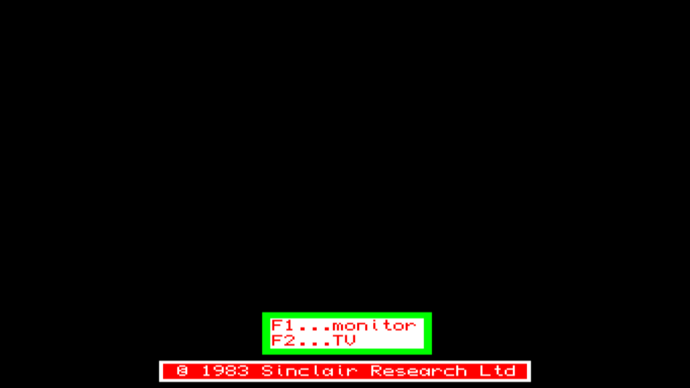

<h1 align="center">esp32ql</h1>

<p align="center">
  <b>A Sinclair QL on a 7-inch ESP32-S3 touch-screen board or an M5Stack Tab5.</b><br>
  A 68008 with the QL's 8-bit bus timing, the ZX8301's two display modes, the JS or Minerva ROM, 128 or 640 KB.
</p>

<p align="center">
  
  
  
  
  
  
</p>

<p align="center">
  <b>Early development:</b> the QL boots to its F1/F2 (monitor/TV) question on both boards; the
  keyboard, Microdrives and sound are being written now.
</p>

<p align="center">
  
  
  <br>
  
  <br>
  <sub>The JS ROM's start-up question on the Tab5 and the MaTouch (mode 8, 256 × 256), and the setup
  screen. Screenshots from the boards.</sub>
</p>

esp32ql turns the Makerfabs MaTouch ESP32-S3 Parallel TFT with Touch 7", or an
M5Stack Tab5, into a Sinclair QL. A setup screen on the touch panel, and a web
page on your network, handle the machine's settings and its Microdrive
cartridges on the microSD card.

It's the sibling of [esp32ste](https://github.com/rlucencic/esp32ste) (Atari
STE), [esp32mac](https://github.com/rlucencic/esp32mac) (Macintosh Plus, SE,
Classic), [esp32mac2](https://github.com/rlucencic/esp32mac2) (Macintosh LC
and II, Tab5 only), [esp32mac3](https://github.com/rlucencic/esp32mac3)
(Macintosh LC II and LC III, Tab5 only),
[esp32cpc](https://github.com/rlucencic/esp32cpc) (Amstrad CPC),
[esp32zx](https://github.com/rlucencic/esp32zx) (ZX Spectrum 128K, +2, +3),
[esp32cbm](https://github.com/rlucencic/esp32cbm) (Commodore 64 and 128),
[esp32xl](https://github.com/rlucencic/esp32xl) (Atari 800XL and 130XE),
[esp32msx](https://github.com/rlucencic/esp32msx) (MSX1 and MSX2),
[esp32gs](https://github.com/rlucencic/esp32gs) (Apple IIGS),
[esp32coco](https://github.com/rlucencic/esp32coco) (Tandy Color Computer 2
and 3), [esp32arc](https://github.com/rlucencic/esp32arc) (Acorn Archimedes,
Tab5 only), [esp32pc](https://github.com/rlucencic/esp32pc) (IBM PC/XT and
PC/AT) and [esp32ami](https://github.com/rlucencic/esp32ami) (Amiga 500,
2000, 600 and 1200, Tab5 only); all are built on the shared runtime
[esp32emu](https://github.com/rlucencic/esp32emu), which also holds the 68000
core (Musashi) this one shares with the ST, the Macs and the Amiga.

## Status

**Working**
- The 68008: Musashi's 68000 with the QL's 8-bit bus (a word costs two byte
  cycles), 20 address lines, 7.5 MHz, a 50 Hz PAL frame of 312 lines.
- Memory: the 48 KB ROM, 128 KB RAM, or 640 KB with a 512 KB expansion.
- The ZX8301's display: mode 4 (512 × 256, four colours) and mode 8 (256 ×
  256, eight colours, flashing), the two screen banks, blanking.
- The ZX8302's frame interrupt and its clock.
- The JS ROM (QDOS 1.10) boots through its RAM test to the F1/F2 question on
  both boards and the host build, at full speed (the Tab5's emulation core
  ~21% busy, the MaTouch's ~64%).

**Next**, in order: the IPC (the 8049: keyboard, sound) through the
ZX8302's link, then SuperBASIC, the Microdrives (`.mdv` cartridge images),
sound, Minerva, and original software (Psion Quill: a document saved and
loaded again).

## Hardware

- **Makerfabs MaTouch ESP32-S3 Parallel TFT with Touch 7"** (ESP32-S3,
  16 MB flash, 8 MB PSRAM, 1024 × 600), or
- **M5Stack Tab5** (ESP32-P4, 1280 × 720).
- A microSD card (FAT32 or exFAT) for the Microdrive cartridges, a Bluetooth
  keyboard (the Tab5: USB too).

## Getting started

You need ESP-IDF 5.5 and [esp32emu](https://github.com/rlucencic/esp32emu)
cloned next to this repository.

1. Put the ROM images into `roms/` (`js.rom`, `minerva.rom`: see
   [roms/README.md](roms/README.md)).
2. Build and flash (`flash` also writes the ROMs into their partition):
   ```sh
   # MaTouch
   idf.py build && idf.py -p PORT flash
   # Tab5
   idf.py -B build-tab5 -DIDF_TARGET=esp32p4 -DSDKCONFIG=$PWD/build-tab5/sdkconfig build
   idf.py -B build-tab5 -DIDF_TARGET=esp32p4 -DSDKCONFIG=$PWD/build-tab5/sdkconfig -p PORT flash
   ```
3. On the setup screen choose the ROM and memory and tap Start. The web page
   is at `http://sinclair-ql.local`.

## Development

The machine (`components/ql`) is platform independent; `components/ql/host`
builds it for a PC, far faster than real time:

```sh
make -C components/ql/host run          # 500 frames of the JS ROM, build/screen.ppm
QL_IO=1 ./components/ql/host/build/ql_host roms/js.rom 200 out.ppm   # every I/O access
```

`host_main.c` lists its other switches (traces, a stop at a PC, typed keys).

## Credits

- The 68000 core: [Musashi](https://github.com/kstenerud/Musashi) by Karl
  Stenerud (MIT), in esp32emu.
- The QL's ROMs: Sinclair Research's QDOS and SuperBASIC (Tony Tebby, Jan
  Jones and others); Minerva by Laurence Reeves. Not part of this
  repository: see roms/README.md.
- The QL's hardware as described in Sinclair's QL Technical Guide and the
  QL community's documentation (Dilwyn Jones's site, sinclairql.net).

## Licence

MIT, see [LICENSE](LICENSE). The ROMs are not covered by it.
